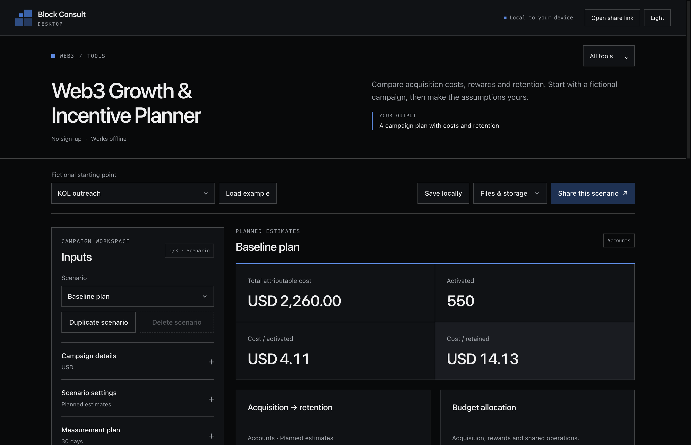

<p align="left"></p>

# Web3 Growth & Incentive Planner

Model campaigns, acquisition costs, incentive budgets and retention. A focused, offline desktop workspace from [Block Consult](https://www.blockconsult.org), available in English and German.

[](https://github.com/blockconsult-org/web3-growth-planner/releases/latest) [](LICENSE) · [Platform builds](https://github.com/blockconsult-org/web3-growth-planner/actions/workflows/release.yml)

**[Download for macOS or Windows](https://github.com/blockconsult-org/web3-growth-planner/releases/latest)** · [Use in your browser](https://www.blockconsult.org/tools/web3-growth-planner) · [Report an issue](https://github.com/blockconsult-org/web3-growth-planner/issues)



## Download and install

| Platform | Download | Installation |
| --- | --- | --- |
| macOS, Apple silicon and Intel | Universal `.dmg` | Open the disk image and drag the app to Applications. |
| Windows 11, Intel/AMD 64-bit | `windows-x64-setup.exe` | Run the per-user installer; administrator rights are not required. |
| Windows, portable | `windows-x64-portable.exe` | Run directly without installing. |

Release notes state the signing and notarization status of each download. Unsigned Windows releases may show a publisher warning. macOS requires macOS 13 or later. Check `SHA256SUMS.txt` against the downloaded file using `shasum -a 256` (macOS) or `Get-FileHash -Algorithm SHA256` (PowerShell). Download only from this repository's Releases page.

## A private workspace

- Calculations and editing work without an internet connection, account or API key.
- English/German UI, light/dark themes, keyboard controls and resizable layouts.
- Existing JSON models and browser share links remain compatible. Use **Open share link** to inspect a shared scenario locally.
- Exports use a native file-save dialog. **File → Save report as PDF** writes a local PDF.
- Drafts stay in this app's local profile; JSON exports are portable backups. Draft behavior follows the original tool (see the tool's save controls).
- No analytics, telemetry, cloud synchronization or automatic uploads. Website and evidence links open in your default browser. Unknown evidence destinations require confirmation.

Share links are readable, encoded snapshots, **not encrypted**. Review the sharing preview and optional inclusion of authored text before copying one. Closing an unsaved workspace can lose edits; save or export first. Opening a share link replaces the current workspace.

## Develop

Install Node.js 24 or newer, then:

```sh
npm ci
npm run build
npm start
```

`npm run dev` runs the renderer in a browser. `npm test` checks the model and desktop security boundaries. `npm run test:desktop` launches real Electron and exercises offline rendering, themes, localization, exports and isolation. Run `npm run build` first.

```sh
npm run verify
npm run dist -- --mac --universal  # on macOS
npm run dist -- --win --x64       # on Windows
```

## Project layout

| Path | Responsibility |
| --- | --- |
| `tools/web3-growth-planner/` | Models, calculations, localized copy, UI and exports |
| `src/` | Desktop frame and small browser-framework adapters |
| `desktop/` | Sandboxed Electron host, local asset protocol, native PDF saving |
| `tests/` | Calculation regressions and real desktop integration checks |
| `.github/workflows/release.yml` | Tests and platform builds; draft releases for version tags |

The original pure model code is preserved. The desktop adaptation changes navigation, share-link origins, local resources and native export handling. Source baseline: `1acdf7a290ef4d54e0b882c9d1b8c2bde79c8f9e`. No website server, portal, client data, credentials or provider integration is included.

## Release and maintenance

See [release instructions](docs/RELEASING.md), [security policy](SECURITY.md) and [contribution guide](CONTRIBUTING.md). Releases are manual downloads; the app does not silently update. Keep the Electron runtime current when maintaining a fork.

These tools support planning and discussion. Results depend on the supplied assumptions and the documented model limitations; they are not a prediction or professional advice.

## License

[MIT](LICENSE) · Copyright © 2026 Block Consult GmbH. Names and logos remain Block Consult trademarks.
