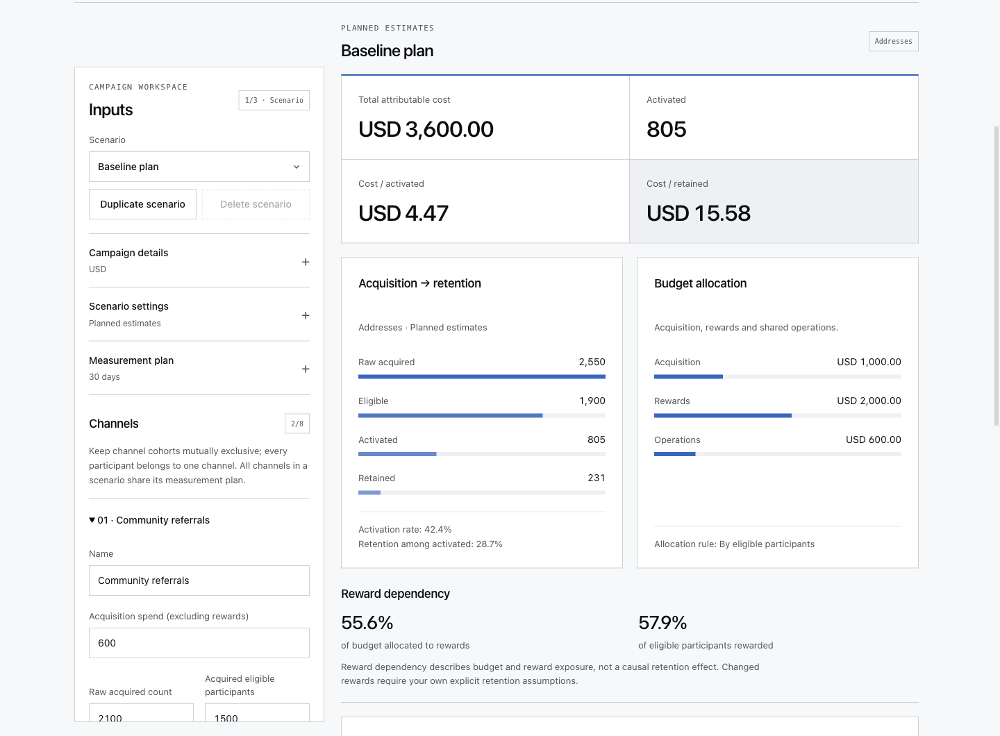

<a href="https://www.blockconsult.org">
  <picture>
    <source media="(prefers-color-scheme: dark)" srcset="public/blockconsult-logo.png">
    
  </picture>
</a>

# Web3 Growth & Incentive Planner

Plan a Web3 acquisition campaign or review its observed results. Define the cohort, activation event and retention window, then enter channel costs, participant counts and cash or token rewards to compare costs per activated and retained participant.

An offline desktop tool from [Block Consult](https://www.blockconsult.org), available in English and German. It supports up to three alternative scenarios with eight channels each, without a wallet connection or live market data.

[](https://github.com/blockconsult-org/web3-growth-planner/releases/latest) [](LICENSE) · [Platform builds](https://github.com/blockconsult-org/web3-growth-planner/actions/workflows/release.yml)

**[Download for macOS or Windows](https://github.com/blockconsult-org/web3-growth-planner/releases/latest)** · [Use in your browser](https://www.blockconsult.org/tools/web3-growth-planner) · [Report an issue](https://github.com/blockconsult-org/web3-growth-planner/issues)


The workspace places channel assumptions beside their campaign outcomes.

## What you can do

- Define an activation event, counting unit, acquisition window, retention window and eligibility rules so each result has a stated measurement basis.
- Use planned activation and retention rates, or enter observed counts. Incomplete retention windows remain unknown rather than becoming zero.
- Model acquisition spend, cash or token rewards and shared operating costs. Review the acquisition-to-retention funnel, budget allocation and cost per outcome.
- Compare up to three scenarios, inspect channel-level results and reward exposure, then export a measurement report, JSON model, PNG summary or PDF.

The planner calculates from your inputs. It does not estimate ROI, lifetime value, token prices or the causal effect of rewards on retention. Currency changes update the label only; they do not convert amounts.

## Get started

1. Select a **Fictional starting point** and choose **Load example**. KOL outreach, developer activation and community onboarding examples are included.
2. Review the **Measurement plan**, then edit channel spend, eligible participants, activation, retention and rewards. Keep channel cohorts mutually exclusive.
3. Inspect the results and use **Duplicate scenario** to compare an alternative. For observed results, mark a retention window complete only after the whole channel has had time to finish it.
4. Choose **Save locally** before closing. Use **Files & storage** for JSON, or export a report or preview **Share this scenario**.

## Screenshots



The fictional community onboarding example uses token rewards and counts addresses. Its figures illustrate the model; they are not performance benchmarks, and addresses are not people.

## Download and install

| Platform | Download | Installation |
| --- | --- | --- |
| macOS, Apple silicon and Intel | Universal `.dmg` | Open the disk image and drag the app to Applications. |
| Windows 11, Intel/AMD 64-bit | `windows-x64-setup.exe` | Run the per-user installer; administrator rights are not required. |
| Windows, portable | `windows-x64-portable.exe` | Run directly without installing. |

Release notes state the signing and notarization status of each download. Unsigned Windows releases may show a publisher warning. macOS requires macOS 13 or later. Check `SHA256SUMS.txt` against the downloaded file using `shasum -a 256` (macOS) or `Get-FileHash -Algorithm SHA256` (PowerShell). Download only from this repository's Releases page.

## Your data

- Calculations and editing work without an internet connection, account or API key.
- English/German UI, light/dark themes, keyboard controls and resizable layouts.
- Existing JSON models and browser share links remain compatible. Use **Open share link** to inspect a shared scenario locally.
- Exports use a native file-save dialog. **File → Save report as PDF** writes a local PDF.
- **Save locally** stores one campaign, including all its scenarios, in this app's profile; saving again replaces that copy. Edits are not saved automatically. Export JSON for portable backups or to keep more than one campaign.
- No analytics, telemetry, cloud synchronization or automatic uploads. Website and evidence links open in your default browser. Unknown evidence destinations require confirmation.

Share links are readable, encoded snapshots, **not encrypted**. Every scenario's numeric inputs, currency, counting unit, windows, reward policy and observation status are included. **Share this scenario** lets you choose whether to also include names, measurement text, notes and evidence links. Review the preview before copying a link. Save or export before closing the app or using **Open share link**. Opening a link replaces the current workspace and can discard unsaved edits; it does not overwrite your saved local campaign.

## Run from source

Install Node.js 24 or newer, then:

```sh
git clone https://github.com/blockconsult-org/web3-growth-planner.git
cd web3-growth-planner
npm ci
npm run build
npm start
```

`npm run dev` runs the renderer in a browser. `npm test` checks the model and desktop security boundaries. `npm run test:desktop` launches real Electron and exercises offline rendering, themes, localization, exports and isolation. Run `npm run build` first.

```sh
npm run verify
npm run dist -- --mac --universal  # on macOS
npm run dist -- --win --x64       # on Windows
```

## Project layout

| Path | Responsibility |
| --- | --- |
| `tools/web3-growth-planner/` | Models, calculations, localized copy, UI and exports |
| `src/` | Desktop frame and small browser-framework adapters |
| `desktop/` | Sandboxed Electron host, local asset protocol, native PDF saving |
| `tests/` | Calculation regressions and real desktop integration checks |
| `.github/workflows/release.yml` | Tests and platform builds; draft releases for version tags |

## Release and maintenance

See the [release instructions](docs/RELEASING.md) for packaging and publishing. Releases are manual downloads; the app does not silently update. Keep the Electron runtime current when maintaining a fork.

This tool supports campaign planning and measurement. Results depend on the supplied assumptions and cohort definitions; they are not forecasts. Reward exposure describes the budget and rewarded share, not proof that an incentive caused retention.

## Contributing and license

Read the [contribution guide](CONTRIBUTING.md) before opening a pull request. Report vulnerabilities through the process in the [security policy](SECURITY.md).

[MIT](LICENSE) · Copyright © 2026 Block Consult GmbH. The license covers the code; it does not grant rights to use Block Consult’s name or logo as an endorsement.
